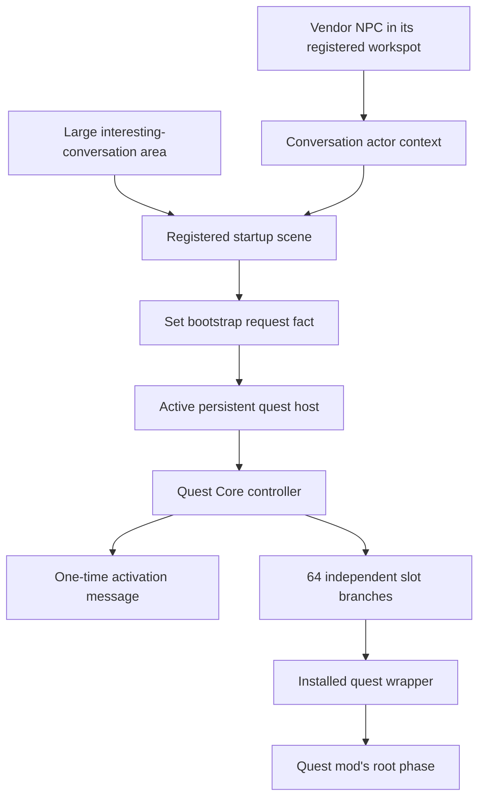

# How Quest Core starts quests

Quest Core connects two game systems: interesting conversations start a short
scene, and an already-active quest graph responds to that scene's request.
The persistent quest graph owns the core controller and the quest phases it calls.



## Interesting-conversation area

A `worldInterestingConversationsAreaNode` asks the game's conversation system
to run a scene. The core generates one in an always-loaded streaming sector.
Its horizontal and vertical bounds cover Night City and the surrounding open
world, including height above and below the vendor.

The conversation binds to the vendor's `fluff_vendor_ws` workspot. Its scene
acquires an actor through that context. An area that is present in the world
does not, by itself, supply the NPC and workspot context for this startup path.

The node's direct `conversations` entry selects the startup scene. Its `workspots`
array supplies the workspot references used for actor context.

Being inside the area allows startup when loading a save, without visiting H10
or walking to the vendor. No spoken dialogue or player-selected conversation
option is part of the core's startup scene.

## Vendor context and streaming

The bootstrap uses an existing Kabuki vendor community and its registered
workspot. The native community supplies the actor and activity context expected
by the conversation system.

The core changes two parts of the vendor's setup:

- Its community spawn phase sets `alwaysSpawned` to true.
- Its compiled community controller and placement use a 100,000-metre streaming
  distance. The core's streaming block includes the vendor sector.

These changes keep the context available when the player loads a distant save.
Expanding the conversation area alone would not keep its vendor context available.

This is a requirement of the core's chosen bootstrap, not a rule that every
quest NPC or vendor needs a community. A quest mod can use directly assigned
[quest-owned workspots](workspots.md#quest-owned-world-activities) for its own NPCs.

## Registered startup scene

The core publishes its generated scene at an existing registered scene path:

```text
base\open_world\scenes\generic_vendors\versions\gold\chinese_food_store.scene
```

The registered path lets the conversation system resolve the scene through an
existing native conversation registration. A new scene file at an arbitrary path
does not create that registration.

The generated scene uses category `otherOpenWorld`, acquires the vendor context,
and exposes `Start 0` and `Start 1`. Both entry points run the same short flow:

1. Set `ghostline_quest_core_bootstrap_started` to 1.
2. Check `ghostline_quest_core_bootstrap_dispatched`.
3. If the core has not been dispatched, set
   `ghostline_quest_core_bootstrap_requested` to 1.
4. End the scene.

The scene signals startup. It does not contain the installed quest mods or own
their running controllers.

## Persistent quest host

A questphase resource must be called from an active quest graph to execute.
The core adds a listener to an existing active branch in:

```text
base\quest\persistent_content.questphase
```

The listener wakes for either its original vanilla condition or the core request.
For a core request, it clears the request fact, checks the saved dispatch guard,
sets `ghostline_quest_core_bootstrap_dispatched` to 1 and calls:

```text
mod\ghostline_quest_core\controller.questphase
```

The original vanilla condition is preserved and rechecked. Its continuation
resumes when that condition is satisfied; otherwise the listener is rearmed.
Handling a core request does not force the vanilla condition to become true.

This active host is the bridge between the temporary conversation scene and the
persistent quest controller. Including a reference to a questphase in a package
does not make that questphase run.

## Controller, message and slots

The controller sets `ghostline_quest_core_active` to 1, starts the status-message
branch and dispatches all 64 quest slots independently. A quest slot does not
have to wait for the message or another quest.

The message branch checks `ghostline_quest_core_notified`. If it is zero, it
activates the core's journal contact and message, then sets the fact to 1:

> Ghostline Quest Core active. Installed quest packs can now start.

The message is part of the core, outside the numbered quest slots. It confirms
core activation, not the correctness of each installed quest mod.

Each slot calls its wrapper at `In1`. A vacant wrapper returns `Vacant`, so the
core waits 15 seconds and retries that slot. A quest wrapper calls its own root
phase. Returning `Done` marks that slot complete for the save. A persistent
series controller keeps running instead.

The dispatch, notification and completion guards are saved facts. Repeated scene
activation does not create another core dispatch, and save/reload does not reset
the notification or slot-completion guards. Quest mods own their own progression,
replay and reward guards. See [slot integration](integration.md).

## Vanilla overrides

| Resource | Core change |
| --- | --- |
| `base\open_world\scenes\generic_vendors\versions\gold\chinese_food_store.scene` | Publishes the generated request scene at the registered path. |
| `base\quest\persistent_content.questphase` | Adds the request listener and core phase call to an active branch. |
| `base\worlds\03_night_city\_compiled\default\always_loaded_1.streamingsector` | Adjusts the vendor spawn phase and includes the shared workspot registrations. |
| `base\worlds\03_night_city\_compiled\default\exterior_-10_16_0_1.streamingsector` | Extends the vendor community controller's streaming distances. |

The core also supplies its own streaming block, conversation-area sector, scene,
controller, status-message resources and empty slot wrappers.

The builder reads the affected vanilla resources from the selected game's
official archives and preserves unrelated data while applying the bootstrap
changes. It rejects incompatible expected layouts.

Another mod replacing one of these four vanilla resources can conflict with the
core. Quest mods using slots leave these overrides to the shared core and replace
only their own slot wrapper and gameplay resources.

## Runtime and build dependencies

The runtime uses native streaming, conversation, scene, quest and journal
resources. The `.archive.xl` file contains JSON registration for the game's
cross-platform loader, supplying the streaming block, journal and localization.
The core does not need the PC
ArchiveXL DLL, CET commands or REDscript to start.

Building the package requires the sibling Quest Builder and ghostline-red
libraries and an installed game. See [building and testing](building.md).
For NPC activities and shared registry limitations, see [workspots](workspots.md).
